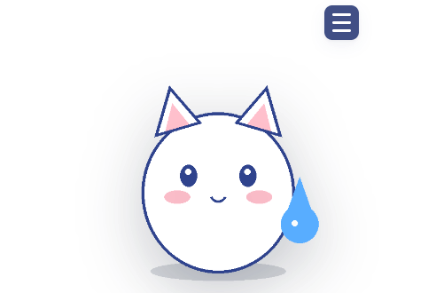
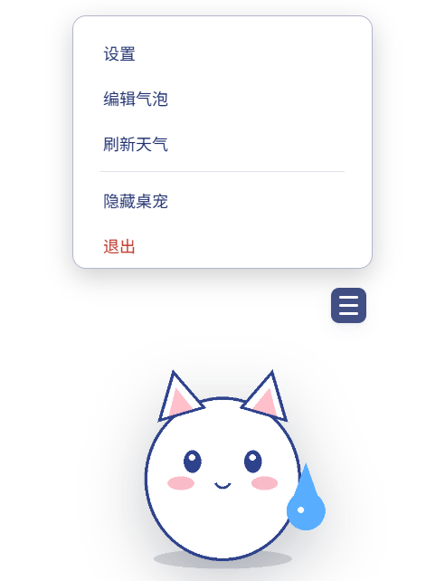
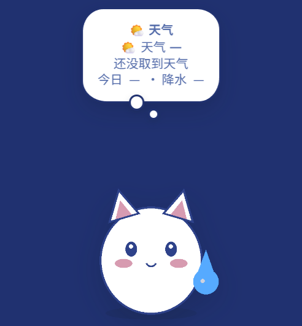
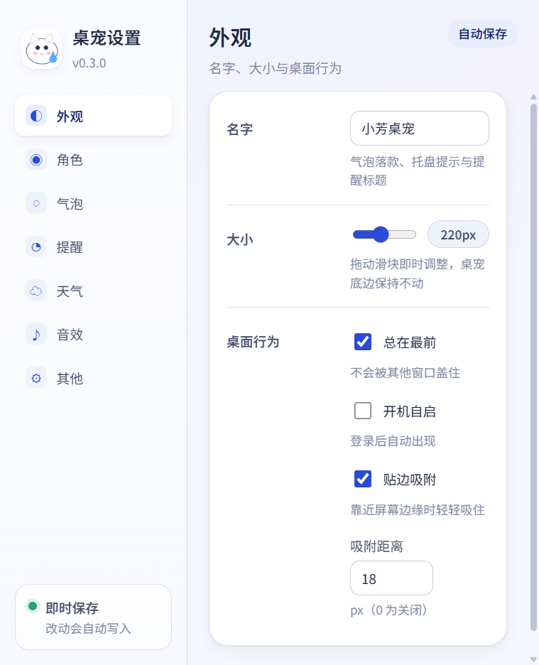
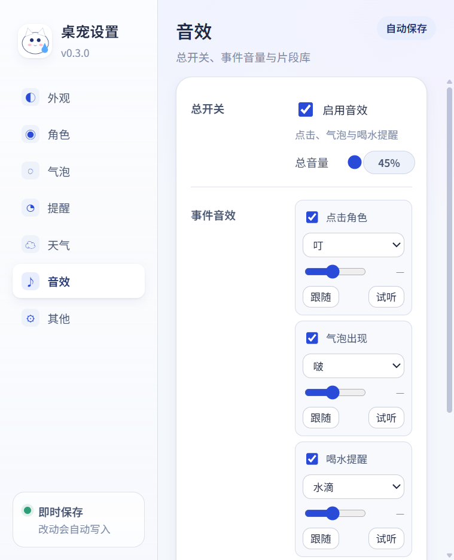

# M10 手感与视觉包（0.4.0）

> 日期：2026-10-20 · 版本：`0.4.0`
> 产物：`dist/DeskPet-0.4.0-portable.exe`（102,710,482 字节，gitignore）
> SHA-256：`fddc6d2ebef5c02bbce45674cfd076c452314a99f79eb04f597fb77d8a51cf7d`
>
> 0.4.1 的交互收尾（去掉双击/桌宠右键、气泡/菜单对齐 whale-widget）见 `M10.1-NOTES.md`。

## 1. 这轮做了什么

| 需求 | 实现 |
|---|---|
| 触摸动态效果 | 按压 `scale(1.05, 0.88)` 底边锚定；松手 0.2s 弹簧回弹；悬停 `1.03` + 轻微上浮；拖动 ≤3° 倾斜；短按也保留 36ms 按下帧 |
| 冒泡思考状提示 | 气泡改为云朵感的圆角轮廓 + 两个向下错落的思考点；打开时 0/130/260ms 依次淡入/放大，关闭反向回收 |
| 悬停菜单按钮 | 鼠标进入角色后 ☰ 在 150ms 内淡入，移出 260ms 后消失；点 ☰ 打开自绘菜单（设置 / 编辑气泡 / 刷新天气 / 隐藏 / 退出） |
| 非悬停点击 | 保留原卡片队列（天气 → 喝水 → 温馨语句 → 收起），叠加 Q 弹、音效与气泡提示；点角色不会出菜单 |
| 设置界面 | 左侧 7 类导航 + 右侧卡片；字段改为“标签 + 控件 + 说明”；角色图库；音效事件行；底部即时保存状态 |
| 字体与排版 | 新增 `app/tokens.css`；内置 `DeskPet Sans`（Noto Sans SC 子集，OFL，约 2.1MB）；宠物、设置、编辑器统一字体/圆角/间距/字号 |
| 贴边镜像 | 宠物贴左/右边缘时水平翻转；判定用宠物矩形而非窗口矩形，默认 24px 边距不会误翻转 |

关键修复：

- **点击队列不再被 pointerdown 重置**：旧的代码在每次 pointerdown 就 `hideBubble()`，导致第二下点击总是重新显示第一张卡。现在只有真正开始拖动才收起气泡。
- **气泡/菜单先预留窗口高度再显示**：避免先显示后被窗口裁掉顶部；隐藏时延迟 200ms 再缩回窗口。
- **默认位置不镜像**：窗口有 `WIN_PAD=54`，窗口右边缘本来就在屏幕外；镜像改为比较宠物矩形，阈值 20px。
- **菜单在 120/360px 角色尺寸下都不越界**：菜单宽度 168px 居中于角色，窗口高度临时增加约 200px。

## 2. 新增/修改文件

- 新增：`app/tokens.css`、`assets/fonts/DeskPetSans-{Regular,Semibold}.woff2`、`assets/fonts/{OFL.txt,FONT-NOTICE.txt}`、`tools/make-font.py`、`docs/m10/*.png`
- 修改：`app/pet.html/css/js`、`app/settings.html/css/js`、`app/editor.html/css`、`app/preload.js`、`app/main.js`
- 版本：`package.json` / `package-lock.json` → `0.4.0`
- 测试：`npm test` 仍为 26 项，全部通过

字体生成：

```bash
PYTHONPATH=.tools/pylibs python tools/make-font.py
```

脚本从 `C:\Windows\Fonts\NotoSansSC-VF.ttf` 实例化 400/600 两个字重，子集到 ASCII + GB2312 + CJK 标点 + 应用用到的字，重命名为 `DeskPet Sans`（避免使用上游 Reserved Font Name），许可文件随包分发。
需要 `brotli`（woff2 压缩）与 `fonttools`；源字体可用 `DESKPET_FONT_SRC` 覆盖。

## 3. 验证记录

### 3.1 开发实例（CDP）

- 悬停：`pet-wrap hover`，☰ `opacity:1`，角色 `matrix(1.03, ...)`。
- 按压：`pressing`，`matrix(1.05, 0, 0, 0.88, ...)`；松开回弹到悬停态。
- 队列（把天气/喝水都设为可用）：天气 → 喝水 → 温馨语句 → 收起，四次点击文本依次变化。
- 菜单：打开后窗口 `innerHeight 220 → 432`，菜单矩形在窗口内；Esc / 点外部关闭。
- 尺寸：120px 时窗口 228×332，菜单 `inside=true`；360px 时窗口 468×572，菜单不越界。
- 镜像：拖到右边缘 `scaleX(-1)`，拖到左边缘恢复 `scaleX(1)`；默认位置不翻转。
- 设置：7 个面板全部 `docOverflow=0`、`panelOverflow=0`（506 与 900 两种视口）；改名后立即持久化，状态显示「已保存」。
- 控制台：无 error。

### 3.2 打包版（0.4.0）

- 启动日志：`packaged=true`、`portableDir=D:\project\deskpet\dist`、`tray created empty=false menu=显示 / 隐藏|设置…|编辑气泡…|刷新天气|separator|退出`、`pet-visible=true onTop=true`。
- 打包版 CDP：
  - `document.fonts.check('13px "DeskPet Sans"') === true`，`document.fonts.status === "loaded"`；
  - 悬停/菜单、气泡、设置窗口都正常；
  - 设置版本显示 `v0.4.0`，侧栏 `176px 330px`，`scrollWidth-clientWidth=0`；
  - 控制台无 error。

### 3.3 截图

| 截图 | 说明 |
|---|---|
|  | 悬停时 ☰ 出现，角色微放大 |
|  | 悬停菜单（窗口向上扩展） |
|  | 深色背景下看两个思考点 |
|  | 重构后的设置外观页 |
|  | 窄窗口下音效事件行自动换行 |

## 4. 本机已知限制

1. **托盘图标仍不显示**：`Tray` 对象/菜单创建成功，但 Windows 通知区/溢出区看不到图标，`getBounds()` 为 `0,0,0,0`；与 M6 时一致，怀疑 Win11 26200 + 安全软件。待签名/干净机器复验。
2. **未签名 exe**：SmartScreen 会拦双击；portable 还会被火绒拦 `%LOCALAPPDATA%\Temp` 写入，测试时需把 TEMP 指到 `D:\...\.tmp-runtime`。详见 `M6-PACKAGING.md`。
3. **抠图入口是占位**：设置 → 角色里的「从照片生成角色（即将支持）」是 disabled 占位，M11 实现。
4. 字体子集覆盖 GB2312 + 应用常用字；极生僻字会回退到系统字体，属预期。

## 5. M11 预告（照片抠图）

- 离线 `u2net_human_seg.onnx`（58MB）+ `onnxruntime-node`，`asarUnpack` 原生模块；
- 选图 → 进度/可取消 → 棋盘格预览 → 胸像框选/缩放/平移 → 保存为角色；
- 失败/无人像时退回「仅缩放导入」；
- exe 体积预计 98MB → 160–170MB，重走本机 64 位 NSIS 打包与安全软件验证。
